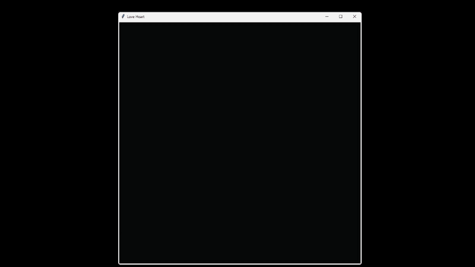

# ❤️ Love Heart Animation

An animated multilingual love heart built with Python, Turtle, and Tkinter.

The program creates a heart shape using different translations of **"I love you"** and animates each phrase into position before adding a subtle shimmer effect.

## Preview

## Features

- ❤️ Heart generated using a mathematical heart equation
- 🌍 "I love you" displayed in multiple languages
- ✨ Animated text appearance
- 💫 Shimmer effect after the heart is complete
- 🎨 Different shades of red across the heart
- 🐍 Built entirely with Python

## Languages Included

Some of the languages used include:

- English
- Spanish
- French
- German
- Italian
- Portuguese
- Russian
- Korean
- Japanese
- Chinese
- Polish
- Greek
- Dutch
- Swedish
- Thai
- Vietnamese
- Turkish
- Ukrainian

## Requirements

- Python 3
- Tkinter
- Turtle

Tkinter and Turtle are normally included with standard Python installations.
